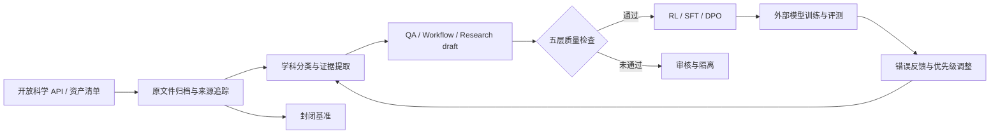

<div align="center">

# HELIX

**Science in motion.**

从开放科学证据，到可验证推理数据的数据飞轮。

`AI4Science` · `Multimodal assets` · `Verifiable rewards` · `Open source`

</div>

HELIX 是一个**可运行的理论态参考实现**：以开放科学资产为起点，组织多模态证据，构造训练任务，用独立验证器筛选，再将模型评测反馈用于下一轮数据处理。

它包含本地 Web 工作台、Python 算法管线、SQLite 存储、官方元数据 API 接入、可扩展原文件导入、RL/SFT/DPO 数据导出，以及完整中文设计手册。

> v0.1 证明数据闭环可以运行。默认样本是原创合成观测，不是真实科研数据集；模板候选不是大模型输出。项目没有宣称完成模型训练或提升科研推理能力。

## 30 秒启动

需要 Python 3.9+。核心项目只使用标准库，无需 Node、npm、数据库服务或模型密钥。

```bash
cd helix
python3 -m helix seed
python3 -m helix run --limit 24
python3 -m helix serve
```

浏览器打开 **http://127.0.0.1:8765**。

页面包含六个部分：飞轮总览、数据宇宙、构造实验室、质量引擎、评测回流、项目手册。

## 数据闭环



### 已实现

| 模块 | v0.1 能力 |
| --- | --- |
| 开放来源 | arXiv、Crossref 官方 API 元数据检索与保存 |
| 多模态资产 | 10 类统一资产协议；本地原文件和许可明确的 HTTPS 文件保存 |
| 文件解析 | CSV 数值列、FASTA 长度、XYZ 几何距离、ASCII STL 面片面积 |
| 分类与去重 | 三级学科候选路径、关键词基线、文本精确去重、原文件 SHA-256 |
| 内容构造 | 数值 QA；开放式 QA、研究流程 DAG、研究方案草稿 |
| 模型接入 | 可选 OpenAI-compatible Chat Completions JSON 接口 |
| 质量与训练数据 | 五层门槛、独立数值/单位验证、RL/SFT/DPO JSONL |
| 数据隔离 | 来源家族稳定划分、holdout 禁止训练导出 |
| 飞轮反馈 | 评测输出验证、学科错误率 EMA、下一批优先级更新 |
| 工程 | SQLite 持久化、幂等数值任务、后台作业、本地 UI、CLI、CI |

### 明确边界

- 图片、视频、音频、PDF 和 STEP 可以作为原始资产归档；其完整语义解析尚未实现。默认演示保存的是带模态标签的 JSON 标注，不附带这些媒体原文件。
- 科研级复杂任务的策略已经设计，当前自动验证闭环使用四类基础统计任务。开放式内容始终待审，不会假装通过科学验证。
- 当前去重是文本精确归一化与字节哈希，不是语义级去重。跨论文、跨图、跨语言泄漏需要后续索引系统。
- 当前反馈影响已有资产的处理顺序，不会自动扩展网络检索，也没有自动训练循环。
- Web 服务面向单人本机使用；不直接暴露到公网。

## 常用操作

```bash
# 实际检索并保存论文元数据；不将可访问等同于可复用
python3 -m helix discover arxiv "scientific machine learning" --limit 5
python3 -m helix discover crossref "molecular dynamics" --limit 5

# 保存并解析一个原创 CSV
python3 -m helix import examples/manifest.json

# 导出联调用演示数据；正式导出应去掉 --include-demo
python3 -m helix export --format rl --include-demo --output exports/demo.rl.jsonl
python3 -m helix export --format sft --include-demo --output exports/demo.sft.jsonl
python3 -m helix export --format dpo --include-demo --output exports/demo.dpo.jsonl

# 核心验证
python3 -m unittest discover -s tests -v
```

AI 接入通过环境变量配置。`.env.example` 仅为示例，程序不会自动加载 `.env`：

```bash
export HELIX_MODEL_BASE_URL="https://your-provider.example/v1"
export HELIX_MODEL="your-model"
# 在本机安全设置 HELIX_MODEL_KEY，不要提交到 Git
python3 -m helix run --provider model --limit 8
```

模型模式会调用真实外部服务，可能产生费用；只读取服务端配置的密钥。没有配置时接口明确报错，不回退为假模型结果。

## 文档

- [详细介绍书 / HANDBOOK](docs/HANDBOOK.zh-CN.md)：理论、算法、模态路线、数据契约、评测与迭代。
- [原策略到实现的映射](docs/STRATEGY.md)：分层归类、置信档位、六维信息核、五层筛选。
- [接口与运行说明](docs/API.md)：API、CLI、部署边界。
- [数据集说明](docs/DATA_CARD.md)：来源、许可、质量、用途和限制。
- [GitHub 发布指南](docs/GITHUB.md)：上传步骤、仓库建议与公开内容范围。
- [实跑复验报告](docs/VERIFICATION-2026-11-23.md)：实际跑通的环节、修复的问题与仍未打通的真实训练链路。
- [版本说明](RELEASE_NOTES.md) 与 [安全策略](SECURITY.md)。
- [科研级构造配置](configs/research_recipe.json)：后续科研生产管线的设计规范，当前不驱动基线引擎。

## 项目结构

```text
helix/           后端、连接器、解析器、验证器、反馈与导出
web/             原生 HTML / CSS / JavaScript 工作台
configs/         科研级构造策略规格
docs/            设计手册、接口与数据卡
examples/        原创样本与可选 GRPO 训练入口
tests/           核心不变量与 API 集成测试
.github/         Python 3.9 / 3.12 CI
data/            本地运行数据（Git 忽略）
```

## License

代码和文档使用 MIT。项目原创演示数据采用 CC0-1.0。外部论文、图像、视频、CAD 和数据集保留各自许可，不能由本仓库统一重新授权。
