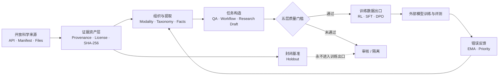

<div align="center">

# HELIX

### Science in motion.

**从开放科学证据，到可验证推理数据。**  
一个面向 AI4Science 的开源数据飞轮参考实现。

<p>
  
  
  
  
  
</p>

[快速启动](#quick-start) ·
[系统架构](#architecture) ·
[真实验证](#verification) ·
[项目文档](#documentation) ·
[能力边界](#boundaries)

</div>
[]
---

## HELIX 是什么

HELIX 是一个**可运行、可检查、可扩展的数据飞轮理论态**。

它从论文元数据、科研文件与结构化观测出发，完成资产归档、来源追踪、任务构造、独立验证、训练数据导出和模型评测回流。每条进入训练出口的数据，都必须能够回答：

> **它从哪里来？经过了什么处理？为什么答案可信？是否污染了基准？**

HELIX 不是一个只展示概念的页面。仓库包含真实可运行的 Python 管线、本地 Web 工作台、SQLite 数据层、来源连接器、文件解析器、验证器、RL/SFT/DPO 导出协议，以及完整的中文设计与复验文档。

> [!IMPORTANT]
> v0.1 证明的是**数据闭环与工程约束能够运行**。它没有宣称已经完成通用科研多模态理解、真实 RL 训练或模型能力提升。默认样本是原创合成观测，所有未验证的科研内容都会进入审核区。

## ✦ 核心闭环



飞轮并不把“生成更多数据”当作终点。它让模型错误改变下一轮数据处理优先级，同时保持来源许可、证据一致性、答案验证和基准隔离不可绕过。

<a id="verification"></a>

## ✦ 真实验证

以下数字来自独立空数据库、真实网络请求、浏览器操作和最终发布包复验，不是页面中的装饰数据。

| 验证项 | 实际结果 |
| --- | ---: |
| 自动检查 | **25 / 25 通过** |
| 原创演示资产 | **14 条 / 10 种模态** |
| 完整模板批次 | **56 条任务** |
| 五层门槛通过 | **36 条** |
| 审核或隔离 | **20 条** |
| 独立答案复算 | **36 / 36 一致** |
| RL / SFT / DPO 导出 | **各 36 条** |
| 真实远程 CSV | **344 行成功下载并解析** |
| arXiv / Crossref | **官方 API 实际接入成功** |

发布前还完成了以下检查：

- 从最终 ZIP 解压后重新运行全部测试、CLI 和 HTTP 服务；
- 在源码目录外隔离安装，分发名正确识别为 `helix-science-flywheel 0.1.0`；
- 校验 ZIP 不含数据库、`.env`、凭证、缓存、checkpoint 或内部文档信息；
- 校验示例 JSONL 与 manifest 的行数和 SHA-256；
- 校验文档本地链接、Git 暂存清单和下载安全响应头。

完整证据见 [实跑复验报告](./docs/VERIFICATION-2026-11-23.md)。

## ✦ 能力全景

| 层 | 已实现能力 |
| --- | --- |
| **开放来源** | arXiv、Crossref 官方 API 元数据检索；Manifest 批量导入 |
| **资产归档** | 10 类统一模态协议；本地文件与许可明确的 HTTPS 文件保存 |
| **内容寻址** | SHA-256 对象存储、文本精确去重、来源家族稳定划分 |
| **文件解析** | CSV 数值列、FASTA 序列长度、XYZ 几何距离、ASCII STL 面片面积 |
| **学科组织** | 学科 → 子学科 → 知识点三级候选路径；七个核心方向 |
| **内容构造** | 数值 QA、证据 QA、科研流程 DAG、研究方案草稿 |
| **模型接入** | 可选 OpenAI-compatible Chat Completions JSON 接口 |
| **独立验证** | Decimal 参考计算、有限值检查、数值容差、单位严格匹配 |
| **质量控制** | 来源许可、证据完整性、结构一致性、答案验证、基准隔离 |
| **训练出口** | RL、SFT、DPO JSONL；来源与划分元数据随样本保留 |
| **反馈飞轮** | 模型输出复算、错误率 EMA、下一轮学科处理优先级 |
| **工程基础** | SQLite、幂等任务、后台作业、CLI、Web UI、CI、安全边界 |

### 支持的资产模态

```text
论文 / 文本    科研图像      实验视频      CAD / 几何      分子 / 晶体
表格 / 时序    代码 / 仿真   音频 / 波形   地理 / 遥感     生物序列
```

统一资产协议允许先归档、后解析。**归档成功不等于内容已被理解**：未配置对应解析器的二进制资产会保留原始文件和来源信息，但不会被伪装成已验证科研数据。

<a id="architecture"></a>

## ✦ 系统架构

```text
┌──────────────────────────────────────────────────────────────────────┐
│                         HELIX WORKSPACE                              │
│  飞轮总览  ·  数据宇宙  ·  构造实验室  ·  质量引擎  ·  评测回流       │
└──────────────────────────────┬───────────────────────────────────────┘
                               │ HTTP / JSON
┌──────────────────────────────▼───────────────────────────────────────┐
│                         PYTHON ENGINE                               │
│                                                                      │
│  connectors ──► asset store ──► extractors ──► synthesis            │
│                       │                              │                │
│                       └──► split isolation           ▼                │
│                                              deterministic verifier  │
│                                                       │              │
│                       feedback ◄── evaluation ◄── exports            │
└──────────────────────────────┬───────────────────────────────────────┘
                               │
                   SQLite + content-addressed objects
```

核心项目只使用 Python 标准库。无需 Node、npm、外部数据库或模型密钥，即可运行完整的离线演示闭环。

<a id="quick-start"></a>

## ⚡ 30 秒启动

### 环境要求

- Python `3.9+`
- macOS / Linux / Windows
- 核心流程无第三方 Python 依赖

### 启动完整演示

```bash
# 克隆或下载仓库后，进入项目根目录
cd helix-science-flywheel

python3 -m helix seed
python3 -m helix run --limit 24
python3 -m helix serve
```

服务启动成功后，再打开 `http://127.0.0.1:8765`。服务未运行时，本地地址无法访问。

本地工作台包含：

1. **飞轮总览**：实际资产、任务、验证和运行计数；
2. **数据宇宙**：按模态、学科和数据划分探索证据资产；
3. **构造实验室**：生成 QA、流程 DAG 与研究方案草稿；
4. **质量引擎**：查看每条任务通过或失败的门槛；
5. **评测回流**：提交模型输出并更新下一轮优先级；
6. **项目手册**：在页面中直接阅读完整设计说明。

### 只运行测试

```bash
python3 -m unittest discover -s tests -v
```

预期结果：

```text
Ran 25 tests

OK
```

## ✦ 一条数据如何穿过 HELIX

### 1. 发现开放来源

```bash
python3 -m helix discover arxiv \
  "scientific machine learning" --limit 5

python3 -m helix discover crossref \
  "molecular dynamics" --limit 5
```

连接器只保存元数据和来源指针。**可访问不等于可训练，可开放获取也不等于允许再分发。** 未明确许可的资产会停留在隔离区。

### 2. 导入并解析原始文件

```bash
python3 -m helix import examples/manifest.json
```

Manifest 示例：

```json
[
  {
    "title": "CSV 解析示例 · 合成压力观测",
    "source_id": "helix-original-csv",
    "source_url": "demo://original/csv",
    "modality": "table",
    "license": "CC0-1.0",
    "local_file": "observations.csv",
    "extract": {
      "format": "csv",
      "column": "pressure",
      "unit": "Pa"
    },
    "is_demo": true
  }
]
```

原始字节以 SHA-256 命名保存，解析事实记录来源哈希和解析器版本。

### 3. 构造并验证任务

```bash
python3 -m helix run --limit 200
```

当前可自动验证的数值任务包括：

```text
mean       算术平均值
delta      末值与首值之差
ratio      末值与首值之比
range      极差
```

这些任务用于证明数据协议与验证闭环。科研级符号推理、代码执行、化学合法性、CAD 拓扑与图像证据验证属于可插拔扩展方向。

### 4. 导出训练数据

```bash
# 正式导出默认排除演示数据
python3 -m helix export \
  --format rl \
  --split train \
  --output exports/train.rl.jsonl

# 联调时显式包含原创演示
python3 -m helix export \
  --format dpo \
  --include-demo \
  --output exports/demo.dpo.jsonl
```

| 格式 | 内容 |
| --- | --- |
| **RL** | `prompt + ground_truth + reward_spec + metadata` |
| **SFT** | 已验证的 `user / assistant` 消息序列 |
| **DPO** | 同一任务的 `chosen / rejected` 候选对 |

`ground_truth` 只供奖励函数使用，不会被拼入模型输入。Holdout 永远不能进入训练导出。

### 5. 记录评测反馈

模型输出经过同一个独立验证器复算：

```text
errorₜ(d) = 0.7 × errorₜ₋₁(d) + 0.3 × (1 − reward)

priority(d) ∝ 1 + 2 × error(d)
```

错误较多的学科会在下一批数据处理中获得更高优先级，但反馈不能修改答案，也不能绕过许可与质量门槛。

## ✦ 五层质量门槛


| 门槛 | 阻止的问题 |
| --- | --- |
| **来源与许可** | 不明确授权的数据被直接用于训练 |
| **证据完整性** | 结构化事实无法回到原始来源 |
| **结构与一致性** | 输出格式、数值和单位相互矛盾 |
| **独立验证** | 让生成模型同时充当自己的裁判 |
| **基准隔离** | 同论文、同资产家族泄漏到训练集 |

同一来源家族先划分 `train / validation / holdout`，再构造派生任务。显式 benchmark 始终进入 holdout，评测反馈也不能把它带回训练调度。

## ✦ 可选 AI 模型接入

HELIX 支持 OpenAI-compatible Chat Completions JSON 接口：

```bash
export HELIX_MODEL_BASE_URL="https://your-provider.example/v1"
export HELIX_MODEL="your-model"
export HELIX_MODEL_KEY="set-this-securely"

python3 -m helix run --provider model --limit 8
```

- 密钥只从服务端进程环境读取；
- `.env`、运行数据库与下载对象不会进入发布包；
- 未配置模型时明确失败，不会静默用模板伪装真实模型结果；
- 模型模式可能产生外部服务费用。

`.env.example` 仅提供变量名，程序不会自动读取或提交本地 `.env`。

## ✦ 项目结构

```text
helix/
├── helix/                  # 数据层、连接器、解析器、构造、验证与反馈
├── web/                    # 无构建步骤的本地 Web 工作台
├── configs/                # 科研级任务构造策略规格
├── examples/               # 原创样本、JSONL 示例、可选 GRPO 入口
├── tests/                  # 单元测试与 HTTP / 边界回归测试
├── docs/                   # 手册、数据卡、API、策略与复验报告
├── scripts/                # 发布归档工具
├── .github/workflows/      # Python 3.9 / 3.12 CI
├── README.md
├── RELEASE_NOTES.md
├── SECURITY.md
└── LICENSE
```

运行时生成的 `data/`、`exports/`、checkpoint、`.env` 和缓存均由 Git 忽略。

<a id="boundaries"></a>

## ✦ 能力边界

为了让项目可信，下面这些内容必须明确区分“已实现”和“设计中”。

### 已经能够完成

- 真实论文元数据检索与来源保存；
- 明确许可文件的安全下载、内容寻址和基础解析；
- 原创结构化观测的批量任务构造；
- 数值答案和单位的独立复算；
- 训练集、验证集与封闭基准的来源家族隔离；
- RL/SFT/DPO 协议导出；
- 模型错误反馈对下一批处理顺序的影响。

### 尚未完成完整链路

- PDF 图文联合理解与公式级证据定位；
- 视频时序理解、图像 VLM/OCR 验证；
- STEP CAD 语义与制造约束；
- 真实科研级问题的大规模专家验证；
- GPU 上的完整 RL 训练与固定基准收益实验；
- 百万级数据任务队列、多租户权限与生产部署。

因此，HELIX v0.1 应被描述为：

> **可运行的数据加工与飞轮参考原型，而不是已经训练出科研模型的生产系统。**

## ✦ Roadmap

- [ ] PDF 页面、公式、图表和引用的统一证据定位
- [ ] 图像 / 视频 VLM 解析与帧级证据协议
- [ ] STEP / CIF / PDB 等科研格式的专用验证器
- [ ] 语义近重复、翻译重复与 benchmark 污染检测
- [ ] 沙箱代码执行与符号数学验证
- [ ] 专家审核工作台和版本化审计
- [ ] 持久任务队列、对象存储和 PostgreSQL
- [ ] 单学科真实模型训练与固定测试集消融实验

<a id="documentation"></a>

## ✦ 项目文档

| 文档 | 内容 |
| --- | --- |
| [详细介绍书](./docs/HANDBOOK.zh-CN.md) | 理论、算法、模态路线、数据协议与迭代方法 |
| [实跑复验报告](./docs/VERIFICATION-2026-11-23.md) | 真实执行结果、修复问题与未打通能力 |
| [策略映射](./docs/STRATEGY.md) | 原始数据飞轮策略到工程模块的映射 |
| [API 与运行说明](./docs/API.md) | HTTP API、CLI、导入协议与部署边界 |
| [数据卡](./docs/DATA_CARD.md) | 演示数据来源、用途、许可与限制 |
| [科研级构造规格](./configs/research_recipe.json) | 学科层级、置信映射与验证器路线 |
| [版本说明](./RELEASE_NOTES.md) | v0.1.0 发布内容与边界 |
| [安全策略](./SECURITY.md) | 私密报告方式与本地部署约束 |
| [GitHub 发布指南](./docs/GITHUB.md) | 仓库创建、上传和 Release 建议 |

## ✦ 参与贡献

优先欢迎以下贡献：

- 新的开放科学来源连接器；
- 学科专用解析器与确定性验证器；
- 多模态证据定位协议；
- benchmark 污染检测与数据质量测试；
- 真实但可再分发的小型科学样本。

提交前请阅读 [CONTRIBUTING.md](./CONTRIBUTING.md)，并运行：

```bash
python3 -m unittest discover -s tests -v
```

## License

- 代码与文档：**MIT**
- 项目原创演示数据：**CC0-1.0**
- 外部论文、图像、视频、CAD 和数据集：保留各自许可

本仓库的 MIT License 不会重新授权外部科学资产。

---

<div align="center">

**HELIX**

*Evidence in. Reasoning out. Better data returns.*

</div>
