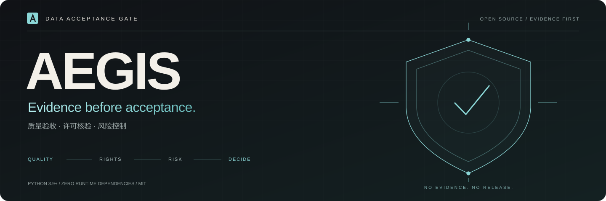

<a id="top"></a>



<p align="center"><b>质量验收、许可与风险控制</b><br>An evidence-led data acceptance gate</p>
<p align="center"><a href="#quickstart">快速开始</a> · <a href="#workflow">验收流程</a> · <a href="#rules">规则策略</a> · <a href="#statistics">统计边界</a> · <a href="#tests">验证结果</a></p>

---

## 让“可以使用”，成为有依据的结论

**让每一次数据放行都有检查结果、使用权限和可追溯的责任依据。**

AEGIS 是一个可运行的开源参考项目：导入签名交付包，扫描记录质量，判断许可范围与风险，记录独立核验人，生成可返回 FORGE 的签名验收报告。

内置原生 Web 工作台、SQLite 持久化、JSON API、三类合成案例和规则测试。Python 3.9+，运行时零第三方依赖。界面采用深色底与青色，直接呈现通过、复核和拒收的证据。

| 运行环境 | 数据存储 | 前端 | 许可 |
|---|---|---|---|
| Python 3.9+ · 零运行时依赖 | SQLite · 本地持久化 | 原生 HTML / CSS / JS | [MIT](./LICENSE) |

> AEGIS 执行明确的规则检查。许可证据由具名人员独立核验；程序不自动鉴定合同真实性，也不替代法律意见。演示数据与示例许可全部为合成数据。

<a id="navigation"></a>

## 导航

| 开始使用 | 理解项目 | 工程参考 |
|---|---|---|
| [快速运行](#quickstart) | [为什么做 AEGIS](#why-aegis) | [设计说明](./docs/ARCHITECTURE.md) |
| [完整操作流程](#workflow) | [验收规则](#rules) | [API 文档](./docs/API.md) |
| [与 FORGE 联动](#forge) | [统计与样本](#statistics) | [交付协议](./docs/PROTOCOL.md) |
| [运行测试](#tests) | [边界与限制](#boundaries) | [数据卡](./docs/DATA_CARD.md) |

<a id="quickstart"></a>

## 快速运行

在解压后的 `aegis` 目录执行：

```bash
python3 -m aegis --demo
```

打开 **[http://127.0.0.1:8042](http://127.0.0.1:8042)**。

首次启动生成三份合成验收案例：

| 案例 | 检查依据 | 初始结论 |
|---|---|---|
| clean | 24 条完整记录，零缺陷，合成许可范围匹配，合成独立核验已记录 | 验收通过 |
| defects | 1 条重复键、1 条缺失文本、1 条错误字段类型，缺陷率 12.5% | 拒收 |
| rights-gap | 内容合格，但许可证据缺失，且没有独立许可核验 | 待复核 |

默认数据库为 `var/aegis.sqlite3`。后续启动保留已有报告。按 `Ctrl+C` 停止。

```bash
python3 -m aegis --demo --port 8142 --db var/experiment.sqlite3
python3 -m aegis --help
```

私有模式需要设置与 FORGE 相同的至少 32 字符随机密钥：

```bash
# 使用你在 FORGE 工作区中配置的同一个随机密钥
export FORGE_AEGIS_KEY='replace-with-your-shared-random-secret'
python3 -m aegis --db var/private.sqlite3
```

程序只监听 `127.0.0.1`。私有数据库初始为空，从工作台导入交付包。`--demo` 使用公开测试密钥，仅适合合成演示。无需 Node、模型 API、外部数据库、网络字体或账户。

<a id="why-aegis"></a>

## 为什么做 AEGIS

“下载成功”并不等于“可以使用”。数据采购的最后一关，应该同时回答：

- 内容是否符合约定的字段、数量和质量？
- 许可证据是否存在，是否允许这次目的、地区和派生使用？
- 有哪些风险尚未确认，谁核验了依据？
- 这个结论究竟对应哪一笔订单、哪一个批次和哪一份文件？

AEGIS 把这些问题收敛成一份带内容绑定的报告：

```text
FORGE 签名交付包
   │
   ├── 验证协议 / HMAC / 规格哈希 / 数据哈希
   ├── 扫描缺失、类型、重复与个人信息线索
   ├── 判断数量、许可范围、有效期及来源声明
   └── 记录独立许可核验人及依据
   │
   ▼
accepted / review / rejected
   │
   ▼
不可原地覆盖的签名报告 ──▶ FORGE 当前订单
```

适用于数据验收流程设计、训练语料治理、科研数据集审查、采购验收教学和规则系统扩展。

<a id="features"></a>

## 已实现能力

| 能力 | 实际行为 |
|---|---|
| 入口校验 | 拒绝无签名、错误签名、未知协议、错误数据/规格哈希及不一致的全量声明 |
| Schema 检查 | 必填字段、空值、纯空白字符串、string/integer/number/boolean 类型 |
| 重复检查 | 唯一键重复或整行完全重复；重复项从第二次出现计数 |
| 缺陷聚合 | 缺失、类型和重复按行集合并集计算，避免一行重复扣分 |
| 统计展示 | 缺陷比例与双侧 95% Wilson 区间 |
| 样本保护 | 供应商提供的样本始终要求复核，不自动推广到整批数据 |
| 许可检查 | 来源、许可标识、证据引用、使用目的、地区、派生权限及到期日 |
| 独立核验 | 明确确认、核验人、依据说明与核验时间；不会覆盖硬性拒收项 |
| 风险提示 | 选定敏感字段与邮箱模式的 PII 线索，缺失来源合规声明 |
| 报告留存 | 原始交付不可覆盖；再次检查追加新报告；保留规则版本和有效期 |
| 工作台 | 导入文件、运行检查、状态筛选、查看证据、导出报告与近期事件 |

<a id="workflow"></a>

## 完整操作流程

1. **从 FORGE 导出交付包。** 文件包含固定采购规格、原始记录、许可声明和签名。
2. **点击“导入交付”。** 选择 JSON 文件或粘贴完整交付包。
3. **核验许可。** 只有在实际检查证据后，勾选独立核验并填入责任人和合同/核验依据。未勾选仍可运行质量检查，但结论为待复核或拒收。
4. **运行检查。** 系统校验文件完整性，再检查记录质量和许可策略。
5. **查看结果。** 页面展示缺陷数、重复数、疑似个人信息、缺陷比例、区间、规则结论及核验记录。
6. **导出签名报告。** 报告绑定订单、批次、规格及原始交付内容，有效期最多 7 天；通过报告不会晚于许可截止日的 UTC 当天结束。
7. **回到 FORGE 导入报告。** 匹配当前交付后应用结论。

再次检查同一个交付会追加新报告。FORGE 每个交付只应用一次决定；若已经应用“待复核”或“拒收”，需要登记新批次后重新验收。

<a id="rules"></a>

## 验收规则

| 结论 | 条件 |
|---|---|
| **accepted** | 无拒收项、无复核项；完整交付缺陷率满足合同阈值，许可声明完整且匹配，独立核验已记录 |
| **review** | 没有硬性拒收项，但样本代表性未验证、许可资料缺失、独立核验未完成或出现 PII 线索 |
| **rejected** | 数量不足、完整交付缺陷率超阈值、使用目的/地区/派生权限明确不符、许可过期或声明禁止来源 |

优先级：**rejected > review > accepted**。

缺失权限不能默认为允许；供应商写下 `rights_verified: true` 不能替代独立核验；核验人员的确认不能绕过明确的权限排除、缺失证据或质量失败。

质量指标按缺陷行集合合并：

```text
defect_rows = missing_rows ∪ schema_rows ∪ duplicate_rows
defect_rate = |defect_rows| / scanned_rows
```

PII 线索独立列为风险，未计入这个契约缺陷率。额外字段不违反 required schema，但同样接受 PII 线索检查。具体规则见 [设计说明](./docs/ARCHITECTURE.md)。

<a id="statistics"></a>

## 统计与样本

AEGIS 区分完整交付扫描和供应商样本：

**完整交付：** `coverage: "full"` 要求 `record_count` 等于随包提供的记录数。全部随包记录都被扫描，质量按实际缺陷比例判断。Wilson 区间仅作为展示，不拿抽样区间替代已扫描总体的实际比例。

**样本交付：** `coverage: "sample"` 表示原始总量可能大于提供记录数。无法独立证明供应商样本具有随机代表性，因此始终进入复核。若 Wilson 上界也超出阈值，再给出统计证据不足提示。

双侧 95% Wilson 区间采用 `z = 1.959963984540054`。例如 100 条零缺陷样本，上界约为 3.6993%；不能把观察到的 0% 缺陷解读为整批绝对无缺陷。

签名保护交付内容的一致性，但不独立证明供应商的全量声明、来源陈述或许可证据真实。

<a id="forge"></a>

## 与 FORGE 联动

两个仓库分别独立运行，互通不共享数据库。协议为 `forge-aegis/1`，两端使用相同可信本地共享密钥。

报告包含：

- 订单 ID、当前交付 ID、规格 SHA-256、记录 SHA-256。
- 原始交付正文 SHA-256、规则版本、检查明细和许可核验。
- 报告 ID、签发时间、最多 7 天且受许可截止日约束的有效期、HMAC-SHA256 签名。

FORGE 验证这些绑定之后才更新订单。修改报告结论、套用其他文件或把旧报告用于新批次都会失败。

此版本共享密钥只有本地受信任服务与操作员可以持有；具有密钥的人可以自行签名。生产集成应采用身份认证、不同签发角色及非对称密钥。详见 [交付协议](./docs/PROTOCOL.md)。

<a id="tests"></a>

## 运行测试

```bash
python3 -m unittest discover -s tests -v
```

24 项检查覆盖真实行缺陷、并集计数、空键与类型边界、统计区间、样本限制、权限缺失/明确拒绝、过期许可、报告许可截止日、PII 脱敏输出、篡改交付、虚假全量声明、陈旧核验、版本留存、整数值浮点的一致性、大整数文件与连接释放。

GitHub Actions 在 Python 3.9 与 3.12 上执行该命令；本地已验证 Python 3.9.6，远程 CI 尚未执行。联合包提供双项目闭环脚本和 21 项真实 HTTP 检查。

联合包中的前端回归检查覆盖无损签名交接、延迟文件读取和权限确认重置。打开编辑器、手工修改及新文件载入完成都会清空原核验声明，避免新交付沿用旧内容的确认。浏览器实测已将通过报告回流到 FORGE。

`integer` 记录字段遵循数学整数语义，`1` 和 `1.0` 等价；小数和布尔值不匹配。签名文件的上传与导出保留原始 JSON，避免大整数精度丢失。每次打开新验收、换文件或修改交付内容都会清除旧许可核验，防止复用上一批的确认。

<a id="layout"></a>

## 目录

```text
aegis/
├── aegis/               # 质量 / 许可规则、签名协议、SQLite、HTTP
├── web/                 # 原生工作台
├── fixtures/            # 合格 / 缺陷 / 许可缺失三种合成案例
├── tests/               # 标准库 unittest
├── docs/                # 设计 / API / 协议 / 数据卡
├── .github/             # CI 与 issue 模板
└── README.md
```

<a id="boundaries"></a>

## 边界与限制

- 本地单用户应用，没有登录、远程授权、正式法律审批或强制身份验证。核验人是归属明确的声明字段，并非身份认证结果。
- 每个交付至多 5,000 条、每个请求至多 8 MiB，全部记录在内存中检查。
- 不抓取合同附件、不验证外部许可网址，不把文件签名当成来源真实性证明。
- PII 只识别部分字段名与邮箱模式，可能漏检和误报。未覆盖医学实体、所有身份证格式或跨字段推断。
- 不检测语义重复、事实正确性、版权抄袭、标注质量、训练集污染或恶意内容。
- 许可截止日按 UTC 日期判断，截止日当天有效。
- 原始交付不可被同 ID 的不同内容覆盖；数据库文件本身仍由本机管理员控制。
- 报告过期后需重新检查；更换密钥需要重新签发或明确迁移。

<a id="roadmap"></a>

## 项目路线

以下方向尚未实现：

| 方向 | 价值 |
|---|---|
| 可信随机抽样器与样本来源证明 | 支持可审计的规模化统计验收 |
| 语义与标注质量检查插件 | 为不同数据类型添加可验证规则 |
| 条款结构化与人工审批队列 | 保留原始证据并分离核验责任 |
| 非对称签名、角色权限和报告撤销 | 支持多人协作及验收凭证生命周期 |
| 大文件流式扫描与外部哈希清单 | 处理超过内存原型范围的数据 |

欢迎围绕数据质量、许可策略、抽样理论、风险规则和验收证据设计贡献。参见 [贡献指南](./CONTRIBUTING.md)、[安全边界](./SECURITY.md) 与 [MIT 许可](./LICENSE)。

[回到顶部](#top)
