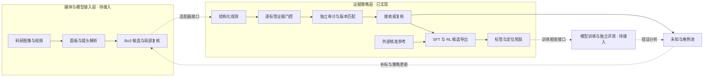

# AI4Science Visual Flywheel

**让科研图像与视频的每一个标签，都能回到证据。**

面向 AI4Science 的视觉数据飞轮研究原型：以多轴标签组织科学媒体，以空间与时间证据验证分类结果，再将满足条件的断言转化为 QA、SFT 与可验证的 RL 任务。

[快速开始](#快速开始) · [系统架构](#系统架构) · [标签体系](#标签体系) · [交互演示](#交互演示) · [验证结果](#验证结果) · [文档导航](#文档导航)

> **项目状态 · v0.1.1**
>
> 已提供理论方案、可运行的证据策略引擎与交互演示。Python 程序消费上游模型或人工产生的结构化观测；视觉模型、OCR、原始媒体解析与训练系统需要接入。当前样例均为合成数据，尚未完成真实媒体识别精度或训练收益评测。

## 项目解决什么问题

科研媒体包含大量容易混淆的视觉表达：一张峰图未必是 XRD，一片灰度纹理未必是 TEM，视频中的气泡也不足以证明某种化学反应。标签一旦错误，后续问答、奖励和训练数据都会继承偏差。

本项目把分类拆解为可检查的断言：**分类什么、作用于哪里、由什么证据支持、在什么范围内通过验收。**

| 常见难点 | 设计方式 |
| --- | --- |
| 同图多个面板，内容与学科混杂 | 按面板、区域、镜头和事件分别标注 |
| 模型三次同意，却共享同一个错误 | Bo3 扩展候选，支持证据按依赖族去重 |
| 粗类正确，细类凭空补全 | 细标签拥有自己的方法证据与准入条件 |
| 几张关键帧被当成看过整段视频 | 区分事件区间与实际观测窗口，计算覆盖并集 |
| 模型自信分被当成准确率 | tune 选阈值，独立 audit 检查精确率下界 |
| 生成答案同时充当自己的奖励标准 | RL 使用外部核准参考和可执行验证器 |

## 系统架构



飞轮的增长单位是**可核验的有效训练任务**。采集数量、生成 token 数与奖励均分作为过程指标，最终仍需检查标签正确性、任务可回答性和独立评测收益。

### 六个核心设计

- **多轴分类**：表达形态、采集方法、专业学科、视频形式、时间事件与任务适用性分别建模。
- **证据定位**：标签关联图像框、视频区间和来源引用；父标签通过不会自动确认子标签。
- **Bo3 与反证**：三份候选扩大搜索范围；复制同一 OCR 或模型描述的意见不能重复计票。
- **时序约束**：检查声明的时间边界、顺序与连续观测覆盖；实体身份和实际状态由上游核验。
- **选择性接收**：证据不足时保留暂定、复核或拒识结果；证书绑定策略、本体、管线与引擎版本。
- **可执行奖励**：当前 RL 验证器检查标签及空间或时间定位，使用独立参考，错误标签得零分。

不同依赖族仍可能共享训练偏差；族数不是统计独立性的证明。98% 或 99% 可以设为验收目标，是否达到必须由独立数据测量。

## 标签体系

**106 个标签 · 72 个标签包含专属证据门槛 · 13 种检查类型**

| 标签轴 | 回答的问题 | 代表性标签 |
| --- | --- | --- |
| `appearance` | 画面如何表达信息？ | 折线、散点、谱图、显微外观、网络图、CAD 渲染 |
| `acquisition` | 如何采集或生成？ | SEM、TEM、AFM、XRD、NMR、CT、MRI、仿真 |
| `subject` | 属于什么专业语境？ | 物理、化学、生物、材料、地球科学与工程 |
| `video` | 片段是什么内容形式？ | 实验实录、数值仿真、科学动画、操作教程 |
| `event` | 时间上看到了什么变化？ | 流动、形变、可见状态变化、装配、仪器操作 |
| `task` | 可以构造什么任务？ | 数值读取、结构读取、时序排序、状态跟踪 |

例如，`appearance.plot.line`、`subject.materials` 与 `acquisition.xrd` 是三个不同命题。确认折线外观，不能直接确认材料学语境或 XRD 方法；每条断言分别取证、分别决策。

完整定义、层级与难负例见 [标签规范](docs/taxonomy.md)；程序配置见 [taxonomy.json](configs/taxonomy.json)。

## 快速开始

### 运行合成示例

需要 **Python 3.10+**。下载或解压项目后，在仓库根目录执行；直接运行示例无需第三方 Python 包或 API 密钥。

```bash
python3 scripts/run_demo.py
```

预期得到以下状态统计：

```json
{
  "assets": 9,
  "statuses": {
    "provisional": 2,
    "human_review": 5,
    "quarantine": 1,
    "abstain": 1
  },
  "sft_candidates": 0,
  "rl_candidates": 0
}
```

示例输出位于：

```text
work/demo/
├── decisions.jsonl        # 逐标签决策、证据与失败原因
├── sft_candidates.jsonl   # 符合条件的候选监督数据
├── rl_candidates.jsonl    # 有核准参考的候选 RL 任务
└── summary.json           # 运行统计
```

合成样例不能认证或进入训练，所以两个训练导出文件为空。这用于验证发布门槛。

### 安装命令行工具

```bash
python3 -m pip install .
visual-flywheel --version

visual-flywheel run \
  --input examples/observations.jsonl \
  --output-dir work/run
```

安装包包含默认标签和策略，命令可从任意目录运行；输入与输出路径仍由调用方指定。源码运行使用仓库 `configs/`，也可通过 `--policy`、`--taxonomy` 显式覆盖。

### 接入真实观测

每行 JSONL 表示一个标注单元，包含来源、许可、质量、候选标签、依赖族和定位证据。按 [输入输出契约](docs/code-contract.md) 准备自己的数据与已验收证书后运行：

```bash
visual-flywheel run \
  --input work/observations.jsonl \
  --calibration work/calibration.json \
  --output-dir work/curated
```

没有匹配证书也可以运行并查看暂定结果，但不能生成训练导出。本地证书依赖可信生产者，没有密码学签名；实际媒体、元数据与人工审核的真实性由接入层负责。

## 决策与训练导出

每个标签单独决策，未列出的标签保持未知，不自动作为负标签。

| 状态 | 含义 | 训练导出 |
| --- | --- | --- |
| `accepted` | 证据、规则和适用证书均通过 | 仅 train 切分可导出；RL 另需核准参考 |
| `provisional` | 达到候选条件，缺少匹配证书 | 不导出 |
| `human_review` | 定位、支持、时序或其他检查未通过 | 该标签不导出 |
| `quarantine` | 来源授权或切分隔离失败 | 整条记录不导出 |
| `abstain` | 没有候选标签 | 不导出 |

一条记录可以同时包含已接收与待复核标签。导出只保留符合条件的局部正标签；RL 任务还必须具备外部审核的问题、参考答案与定位目标。

当前奖励函数要求标签完全匹配，再检查框 IoU 或时间 IoU。科学机理、开放解释、数值推导与因果问题需要各自的真值和验证器，参见 [评测协议](docs/evaluation.md)。

## 交互演示

```bash
python3 scripts/build_site_docs.py
python3 -m http.server 8000 --directory docs/site --bind 127.0.0.1
```

打开 [本地演示](http://127.0.0.1:8000)，可以：

- 切换图像与视频样例，检查 Bo3 候选及证据账本。
- 调整依赖族和质量门槛，观察标签与任务如何进入复核。
- 搜索代表性标签，查看分类边界。
- 下载当前示例 JSON，检查决策和任务目标。

**验证判例：120 秒的视频只检查了 12 秒。** 页面将相关标签送入复核，清空任务目标，并保持训练导出关闭。以下是合成示例的实际浏览器截图：


页面是独立的简化规则演示，不调用视觉模型；Python 策略提供后端参考实现。发布到 GitHub Pages 的步骤见 [发布指南](docs/github-guide.md)。

## 验证结果

截至 **2026-11-23**，v0.1.1 完成以下软件行为验证：

| 验证范围 | 结果 |
| --- | --- |
| Python 规则、统计与异常输入 | 42 项测试通过 |
| 独立环境安装与完整命令行流程 | 8 项模拟测试通过 |
| 页面策略与事件逻辑 | 16 项测试通过 |
| 静态页面资源、锚点与渲染 | 15 个 HTML 文件检查通过 |
| 浏览器切换、搜索、文档与下载 | 实际操作通过，下载文件内容已核对 |
| 源码包解压运行 | 示例与站点检查通过 |

测试曾发现并修复审计图片重复计数、坏输入中断批次、哈希大小写绕过、视频覆盖误判、安装默认配置缺失及说明页渲染问题。详细记录见 [验证报告](VALIDATION.md) 与 [机器可读结果](verification-results.json)。

**这些结果验证软件行为，不代表真实媒体识别精度或模型训练收益。**

复现主要检查：

```bash
PYTHONPATH=src python3 -m unittest discover -s tests -v
python3 scripts/verify_workflow.py
node tests/web_policy.cjs
python3 scripts/build_site_docs.py
python3 scripts/check_site.py
```

页面逻辑测试需要 Node.js 18+。完整流程使用临时测试替身，模拟可信上游；证书与训练候选自动删除，不作为真实认证发布。

## 数据如何进入飞轮

**采集与登记 → 单元解析 → 候选识别 → 证据筛选 → 独立验收 → 任务构造 → 训练评测 → 错误回流。**

样本分配同时考虑模型分歧、随机审计、新来源、长尾类别与难负例。源论文、视频母片及其派生数据按来源组切分，避免同一内容进入训练和评测两侧。QA 先建立事实表，再选择可回答、可验证的问题；难度由证据和任务需要决定。

具体选样、分池、去重与发布策略见 [数据策略](docs/data-strategy.md)。

## 文档导航

| 想了解什么 | 阅读入口 |
| --- | --- |
| 完整算法与设计依据 | [技术说明](docs/whitepaper.md) |
| 标签定义、层级与混淆边界 | [标签规范](docs/taxonomy.md) |
| 标注、仲裁与证据要求 | [标注指南](docs/annotation-guide.md) |
| Bo3 与独立 Verifier 编排 | [提示词与编排](docs/prompts.md) |
| VLM、OCR、视频解析和后端服务 | [模型接入](docs/model-adapters.md) |
| JSONL、校准、导出和奖励接口 | [代码契约](docs/code-contract.md) |
| 精确率、覆盖率、成本与训练收益 | [评测协议](docs/evaluation.md) |
| 主动采样与数据增长 | [数据策略](docs/data-strategy.md) |
| 项目对外介绍 | [项目介绍](docs/project-introduction.md) |
| 上传仓库与发布页面 | [GitHub 指南](docs/github-guide.md) |
| 公开论文与组件来源 | [参考资料](docs/references.md) |

## 仓库结构

```text
ai4s-visual-flywheel/
├── configs/                # 标签本体与接收策略
├── src/visual_flywheel/     # 证据门控、校准、导出与奖励
├── examples/               # 明确标识的合成观测
├── scripts/                # 演示、流程验证与静态说明生成
├── tests/                  # Python 回归与页面逻辑测试
├── docs/
│   ├── assets/             # README 封面与验证截图
│   ├── site/               # 可独立发布的交互页面
│   └── *.md                # 算法、标注、数据和评测文档
├── .github/workflows/      # CI 与手动 Pages 发布
├── README.md
├── VALIDATION.md
└── LICENSE
```

## 路线图

- [x] 图像与视频多轴标签、方法门槛和标注规范。
- [x] 逐标签证据策略、独立认证、训练候选与定位奖励。
- [x] 合成示例、回归测试、命令行安装与交互演示。
- [ ] 真实视觉模型、OCR、面板解析、抽帧和事件追踪适配器。
- [ ] 独立金标、跨来源精度、覆盖率和成本评测。
- [ ] 采集调度、近重复索引、审核平台和持久化血缘。
- [ ] 训练框架接入、同预算数据消融与下游收益实验。

原生 CAD、音频和论文全文推理可沿用资产、证据、任务与验证器接口扩展；当前版本聚焦图像和视频。

## 参与贡献

欢迎提交带有明确复现步骤的问题，以及标签定义、难负例、模型适配器和验证器改进。涉及接收或奖励语义的修改，请同时提供回归用例并更新版本约束；提交媒体示例时附来源、许可与预期判定。

## 许可

原创代码、文档、页面与合成示例采用 [MIT License](LICENSE)。外部媒体、模型和数据集遵循各自许可。本仓库未打包第三方原始科研媒体、模型权重或内部文档。
