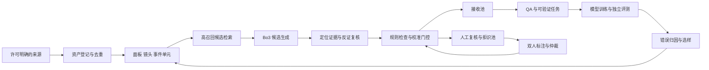

# AI4Science 图像与视频数据飞轮技术说明

版本 0.1.0 · 方法设计与参考实现 · 2026 年 11 月

本方案把公开科研图像和视频转换为可追溯的标签、问答与可验证训练任务。核心目标是提高**自动接收标签的精确率**，同时明确记录为此牺牲的覆盖率、成本和细粒度。项目提供可运行的证据决策与奖励程序；视觉模型、爬虫、媒体处理和训练集群需要按接口接入。没有真实数据评测时，不报告识别准确率或模型训练收益。

## 1 目标与范围

输入包括论文配图、科学图表、显微图、实验照片、结构示意图、分子渲染、地图遥感、医学影像、CAD 渲染，以及实验录像、仿真、科学动画和教学视频。输出围绕三个可审计对象组织：

- **资产记录**：原始来源、许可、内容哈希、版本、派生关系、处理日志。
- **标签断言**：标签作用于哪个面板、区域、镜头或时间段；由什么观测支持；在哪个版本的规则下通过。
- **训练任务**：问题、输入媒体、独立参考答案、验证函数、适用条件和数据切分。

“图方向”同时覆盖静态图像、科学图表和示意图中的图结构。原生 STEP、B-rep、网格等 CAD 几何属于后续模态；仅看渲染图不能恢复可信的参数化 CAD 真值。音频在视频中作为辅助证据，不把字幕或讲解当成画面已发生某事件的证明。

## 2 精准的定义

对标签 $l$，令 $A_l$ 是自动接收的断言集合：

$$\operatorname{Precision}_l=\frac{\#\{\text{被接收且标注正确的断言}\}}{|A_l|}.$$

同时报告接收率 $|A_l|/N_l$、召回率、人工复核率、标签深度、跨来源性能和每个正确断言的成本。多标签任务不能只报总体 accuracy，也不能用“有一个标签正确”掩盖其余错误。

初始研发可以把常见形态标签的目标设为 98%，把用于严格监督的细标签目标设为 99%；这些是**验收目标**。是否达到目标由独立审计数据决定。难类样本不足时，输出父级或 `unknown`，不为了填满三级分类而猜测。

## 3 架构与五层筛选

| 层 | 处理内容 | 可以阻止的错误 | 失败后的去向 |
| --- | --- | --- | --- |
| G0 来源与资产 | 权利、重复、损坏、来源与切分 | 不能发布、重复污染、解码失败 | 隔离或待核权 |
| G1 可观测结构 | 面板、图表、文字、对象、镜头 | 用整页内容误判局部 | 重切分、降级 |
| G2 候选与多视角 | 检索、Bo3、专家路由 | 单模型漏类、类别混淆 | 扩充候选、未知类池 |
| G3 证据验证 | 局部复看、硬规则、反证、时序 | 术语幻觉、字幕诱导、时间颠倒 | 最多两轮修复或人工 |
| G4 校准与发布 | 冻结策略、独立审计、版本绑定 | 高分低准、校准外泛化 | 暂定标签、禁入训练 |

G0 和 G4 是硬门槛。视觉语义分再高，也不能抵消来源不明、证据缺失或校准不适用。

## 4 标签体系

将“长什么样”和“研究什么”分轴建模。标签系统允许多个学科和多种视觉表达共存，只有真正互斥的属性才施加排他约束。完整标签与判例见 [分类体系](taxonomy.md)。

| 轴 | 示例 | 证据要求 |
| --- | --- | --- |
| 表达形态 | 折线、散点、热力、显微、装置照片、流程图 | 可见结构与区域定位 |
| 学科 | 物理、化学、生物、材料、地球科学、工程 | 画面、可核对文字或可信元数据；记录证据渠道 |
| 专业对象或方法 | XRD、NMR、细胞、分子、CAD 渲染 | 细标签的专属支持条件，不能继承父类自信 |
| 视频事件 | 可见流动、形变、状态变化、装配 | 连续时间窗、状态变化与必要前后帧 |
| 任务适用性 | 数值读取、比较、空间关系、顺序判断 | 问题是否能由现有证据唯一回答 |

标注粒度是 `asset → page/panel/shot → region/event → assertion`。多面板论文图可同时含 TEM、折线和结构示意；不能强行给整张图唯一“主类型”。标签记录 `observed / context_supported / inferred`；推测信息留在候选层，不伪装成纯视觉标签。

## 5 图像识别算法

### 5.1 保留原图并拆分局部

记录原始尺寸、颜色、方向和哈希。先判断是否为整页、多面板或单图，再做面板检测。每个 crop 保存原坐标变换，避免裁剪后丢失轴标题、图例或比例尺。对正文图注建立单独通道，保持 `image_only` 和 `image_plus_context` 可区分。

基础质量按用途判断：低分辨率可能不适合读数，却仍能辨认折线；高分辨率不代表实验结论可靠。水印、文字密度和复杂度是特征，不是科学价值的直接替代量。地图、野外照片和简单装置也可能有科研价值。

### 5.2 高召回路由

用视觉嵌入检索每个粗类的正例原型与易混淆负例，得到 top-k 候选。SigLIP 2 一类编码器可作为路由组件，但相似度不等于概率，也不直接生成最终学科真值。[SigLIP 2](https://arxiv.org/abs/2502.14786)

第一层只问“照片、图表、示意、渲染、混合、未知”；第二层由对应专家识别轴、谱峰、节点连线、比例尺等；第三层才判断专业方法。路由低置信或接近边界时同时保留多个分支，避免粗类误判把后续路径永久关闭。

### 5.3 三份候选与 Bo3

本项目把用户提到的 BO3 解释为 **Best-of-3**。对同一单元生成三份受约束候选：

1. A：只看原始画面，输出可见结构和候选标签。
2. B：看高分辨局部与 OCR，独立定位支持点并检查容易混淆的邻类。
3. C：使用另一模型族或专用专家，先寻找反例，再输出支持、反对或未知。

A、B、C 都不得看到对方的答案。若只有同一模型的三种提示词，必须记录同一 `dependency_family`。同一 OCR 结果被三次引用，也只算一个依赖源。多源一致能降低部分错误，但不同模型仍可共享训练偏差，不能声称统计独立。

Bo3 选择的是**候选标签包**；后续对包内每个标签单独门控。整包总分高不能带过一个缺证据的细标签。多数投票是另一条基线，不与 Best-of-3 混用。Bo3 与奖励模型过度优化均可能放大验证器偏差，必须保留拒识出口。[奖励模型过度优化研究](https://proceedings.mlr.press/v202/gao23h.html)

### 5.4 证据形式与图像专用验证

每条断言至少给出标签、`unit_id`、区域或全图作用域、证据类型、支持/反对、模型及权重版本。模型陈述“我看到了比例尺”只是观测提案，还需检查该比例尺实际位置和可读性。

| 候选 | 必查证据 | 必查反例 | 缺失时输出 |
| --- | --- | --- | --- |
| 折线图 | 坐标系统、连线的数据轨迹 | 管线连线、装饰性非数据曲线 | 更粗的图表或未知 |
| XRD | 可核对的方法元数据与衍射方法特征，两者均须确认 | 泛化峰图、拉曼、质谱 | 谱图候选，拒绝猜方法 |
| NMR | 可核对的方法元数据、核种或化学位移等方法特征 | FTIR、普通峰线、缺少 NMR 方法依据的二维热力图 | 粗谱图 |
| SEM 与 TEM | 可核实图注或设备信息，图像特征为辅助 | 灰度纹理、合成显微图 | 显微图 |
| CAD 渲染 | 几何外观和来源类型 | 实物照片、游戏模型、有限元云图 | 三维渲染 |
| 分子结构 | 元素/键或可核实结构数据 | 抽象球棍示意、天体轨迹 | 结构示意候选 |

先从证据提炼结论，再允许编写描述。可选遮挡测试用于检查模型是否依赖候选区域；只有对语义保持的变换才适合做一致性验证。旋转坐标图、翻转手性结构、裁掉负号都可能改变真值，不能当作“应保持标签不变”的增强。

## 6 视频识别算法

### 6.1 时间是真值的一部分

一个视频不是一组随机图片。保存容器时间基、原始呈现时间戳、帧号与转码映射；可变帧率不能用“帧数除以平均 fps”替代所有事件时间。分开处理镜头切换、逐渐转场、重复播放、快放和静帧讲解。

采样预算为：

$$B=\min(B_{max},B_{uniform}+B_{shot}+B_{motion}+B_{uncertainty}).$$

建议先用每镜头首、中、末帧加低频全局采样，再在运动、OCR 变化和模型分歧区域加密。低频率与具体帧预算是可调初值，不是保证；快反应、高速显微和小物体运动需要提高采样率或专门处理。超预算仍无法辨识的事件进入人工池。[PySceneDetect](https://github.com/Breakthrough/PySceneDetect)

### 6.2 镜头与事件分层

帧级模型负责对象、仪器、文字、图表与状态；视频模型负责连续动作与转变；追踪器连接对象身份。SAM 2 可用于视频分割和追踪辅助，但掩码本身不能证明物体类别或事件语义。[SAM 2](https://arxiv.org/abs/2408.00714)

每个事件保存：`[start_s,end_s]`、对象 id、前状态、后状态、证据帧、来源镜头、可见性和局部连续观测覆盖。时间窗内的采样点不是连续覆盖区间；只有实际处理的短片段才能计为覆盖。多段区间合并后求并集，不能重复累计重叠片段。

### 6.3 视频专用三路候选

- A 在全局采样上提出内容类型和事件候选。
- B 在原始时间序列的局部短片上核验对象与状态变化。
- C 独立检查时间方向、剪辑、相似事件和字幕冲突。

静帧里“液体旁有烧杯”不足以证明倾倒。字幕说“加热”不足以证明画面正在加热。“出现气泡”不能自动升级为化学反应、沸腾或某种产物；这些细分结论需要额外条件。

### 6.4 时间约束

生产验证器应检查 `0 ≤ start < end ≤ duration`、原始 PTS 与转码映射、时间戳单调、同一事件跨帧身份一致，以及要求的前后状态是否在证据窗内。参考程序只校验已声明的时间、区间与顺序关系；它不读取实际 PTS，不核验实体身份或前后状态语义，这些事实须由上游模型、工具或人工确认。事件顺序题应由两个独立核准区间生成：只有 $end(A)+\epsilon < start(B)$ 才判 A 先于 B；时间不确定范围重叠则拒绝生成唯一顺序题。

针对可逆过程可检查倒放是否改变标签；针对动作存在性可遮掉字幕再复核。重排帧仅用作时间依赖压力测试，不能作为新物理实验真值。影片剪辑不能建立因果；时间上的先后也不等于机制因果。

## 7 标签决策与多轮验证

对单元 $u$、标签 $l$，计算候选特征：视觉匹配、定位质量、方法专属证据、文本一致性、否定证据、来源新颖度和依赖族数。生产系统可在训练集上学习排序器，再用 tune 集选择阈值；参考实现使用透明规则与分数门控，不把加权分数伪装成概率。

$$\operatorname{accept}(u,l)=G_{rights}\land G_{quality}\land G_{evidence}(u,l)\land G_{constraints}(u,l)\land G_{calibration}(u,l).$$

`G_evidence` 同时要求足够的不同依赖族、适当区域或时间定位，以及细标签专属证据。满足反证结构和定位要求的明确反证不能被低质量支持票平均掉。互斥只在同一作用域检查；同页多个面板或视频不同片段的不同形态可以共存。当前本体默认不设全局互斥，参考引擎保留相应扩展接口。

多轮是带预算的故障修复：

| 轮次 | 输入 | 动作 | 停止条件 |
| --- | --- | --- | --- |
| 第一轮 | 原图或全局视频 | 提名与基本验证 | 证据齐备进入门控 |
| 第二轮 | 具体失败原因 | 放大、重 OCR、加密时间、调用专用模型 | 新证据补足；否则人工 |
| 第三轮 | 持续冲突的断言 | 人工或独立专家仲裁 | 仍不可判就 unknown |

默认自动修复最多两轮。每次必须增加证据或修正定位；同图同模型换措辞重复打分，不算增加证据。保留各轮版本，不把修改后的答案回填为旧轮“独立意见”。

## 8 阈值校准与精确率验收

固定模型、提示词、候选策略、标签定义和全部门控后，用 tune 集挑选阈值，再在未查看过的 audit 集评价**完整接收策略**。对某个标签、模态和已定义来源 cohort，审计中有 n 个被接收断言，其中 k 个经人工判定正确。单侧 Clopper–Pearson 下界为：

$$L=\operatorname{Beta}^{-1}(\delta;k,n-k+1),\quad k>0;\qquad L=0,\ k=0.$$

只有 $L\ge p_{target}$ 才发布这一范围的自动接收资格。若同时认证 M 个标签范围，使用事先确定的 $\delta/M$ 控制一次认证批次的多重检验；持续多批重复验收需另设误差预算或序贯方法。参考实现使用精确二项尾概率反演，不依赖 SciPy。[NIST 二项比例区间](https://www.itl.nist.gov/div898/handbook/prc/section2/prc241.htm)

单个预先确定标签，95% 单侧置信度、要求精确率下界至少 99%，在零错误的理想审计中也至少需要 299 个被接收的独立样本。多标签同时认证或出现错误时需求更高。同视频相邻帧、同论文多个图和转码副本不能假装成独立样本；校准单位应以来源组采样，或使用适当的分组统计方法。

这是给定分布与固定接收规则下的总体比例置信声明，不是每个样本有 99% 正确概率，也不是新网站、新设备或新学科的无条件保证。来源漂移、模型升级、标签变更和新增门控均触发重新验收。参考实现绑定 taxonomy、policy、pipeline 版本和 cohort；真实生产仍需可信审计数据与访问控制。

Conformal Risk Control 提供了控制合适损失的另一类框架，但集合覆盖、漏标风险和接收断言的 precision 是不同目标。本项目不把普通 conformal prediction 的覆盖保证直接称为精确率保证，也没有在参考代码中实现 CRC。[Conformal Risk Control](https://arxiv.org/abs/2208.02814)

## 9 从标签到 QA 和 RL 数据

先建立独立事实表，再围绕可回答性生成问题。问题越难不等于越好；增加虚构前提、堆叠术语或强行六步推导会损坏真值。训练目标应是看清证据、正确计算、合理拒答。

| 层级 | 图像任务 | 视频任务 | 真值来源 |
| --- | --- | --- | --- |
| 感知 | 标签与区域、轴文字、图例 | 对象与事件区间 | 人工标注或独立核准参考 |
| 关系 | 面板比较、图结构路径 | 先后、重叠、持续时间 | 结构化事实表 |
| 计算 | 表格运算、误差与单位 | 核准时间戳的差值 | 数据文件与确定性程序 |
| 推理 | 给定假设下的科学问题 | 给定事件和条件的解释 | 可执行模拟、形式检查或专家 |

参考实现只导出其验证器能检查的标签与定位任务；计算、科学机理与 Paper 生成是扩展设计。模型提出的答案不能同时充当独立参考。自动判定的接收标签可进入候选 SFT 池；用于严格 RL 的任务还要求可信参考和可执行验证器。生产发布建议对 SFT 也执行人工抽检。

RL 样本不是“正确答案加一长段思维链”。最小对象是 `prompt + media + reference + verifier_version + reward_contract`。用户模型可自行 rollout；验证器只检查允许输出的最终结构和证据，不奖励文字长度或模型自信。

## 10 数据飞轮如何增长

将失败分为感知、OCR、定位、时序、方法混淆、来源漂移、标签体系缺口和题目不可回答。每一类对应可执行修复：补局部高分辨样本、重采样事件边界、收集难负例、修订标注规范或新增适用的专家。

采样分数可以组合分歧、风险、稀有类、来源新颖度与预期训练收益；权重须通过实验选择。采用“模型不确定样本 + 随机已接收样本 + 新来源 + 长尾覆盖”的混合采样。若只标模型不确定的样本，就不能无偏估计全量精确率。详细配方见 [数据策略](data-strategy.md)。

训练后用固定、隔离的评测集和一个新来源外测集测量收益。失败样本进入训练前，先将其从任何评测切分中排除；不能一边补答案一边把同题分数上涨称为泛化收益。每轮发布保存来源 manifest、切分 manifest、标签差异、验证器版本和成本报告。

## 11 可交付形式与实现边界

本仓库包括机器可读标签表、标注规范、证据门控、精确率认证工具、SFT/RL 导出、规则奖励、合成失败示例和交互解释页面。它能验证“输入观测满足什么规则才允许进入训练”，不能直接证明输入观测来自真实画面。真实图片和视频必须由模型适配器或人工产生观测，再按独立金标验收。

后端生产组件采用对象存储保存资产、关系库保存断言与版本、队列执行解析和模型任务。推荐按内容哈希和管线版本生成任务键，失败可重试，人工仲裁可撤销，派生数据能随来源撤回。组件接口见 [接入指南](model-adapters.md)，验收实验见 [评测协议](evaluation.md)。
