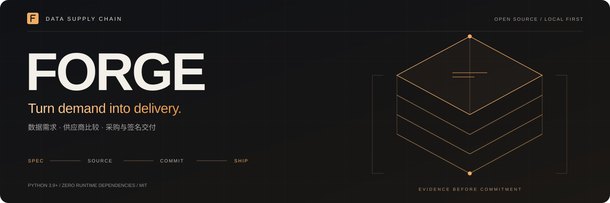

<a id="top"></a>



<p align="center"><b>数据需求与采购供应链</b><br>A local-first data procurement workbench</p>
<p align="center"><a href="#quickstart">快速开始</a> · <a href="#workflow">操作流程</a> · <a href="#rules">采购算法</a> · <a href="#aegis">验收联动</a> · <a href="#tests">验证结果</a></p>

---

## 从需求，到有证据的交付

**把“想要一批数据”变成有规格、有比较、有交付、有验收的采购记录。**

FORGE 是一个可运行的开源参考项目：定义数据需求，录入供应商报价，进行硬条件筛选与成本比较，生成采购草案，登记交付，再导入 AEGIS 的签名报告完成验收。

内置原生 Web 工作台、SQLite 持久化、JSON API、合成样本和规则测试。Python 3.9+，运行时零第三方依赖。界面采用深色底与琥珀色，信息围绕需求、报价和交付排列。

| 运行环境 | 数据存储 | 前端 | 许可 |
|---|---|---|---|
| Python 3.9+ · 零运行时依赖 | SQLite · 本地持久化 | 原生 HTML / CSS / JS | [MIT](./LICENSE) |

> 演示供应商、记录、价格、许可证据全部为合成数据。声明质量不等于实测质量。软件记录本地采购单，不联系供应商、不付款。

<a id="navigation"></a>

## 导航

| 开始使用 | 理解项目 | 工程参考 |
|---|---|---|
| [快速运行](#quickstart) | [为什么做 FORGE](#why-forge) | [设计说明](./docs/ARCHITECTURE.md) |
| [完整操作流程](#workflow) | [采购规则](#rules) | [API 文档](./docs/API.md) |
| [与 AEGIS 联动](#aegis) | [边界与限制](#boundaries) | [交付协议](./docs/PROTOCOL.md) |
| [运行测试](#tests) | [项目路线](#roadmap) | [数据卡](./docs/DATA_CARD.md) |

<a id="quickstart"></a>

## 快速运行

在解压后的 `forge` 目录执行：

```bash
python3 -m forge --demo
```

打开 **[http://127.0.0.1:8041](http://127.0.0.1:8041)**。

首次启动写入 1 份合成需求与 4 家合成供应商报价。数据默认保存在 `var/forge.sqlite3`。后续启动保留已有记录，不重复播种。

```bash
# 自定义端口和数据库
python3 -m forge --demo --port 8141 --db var/experiment.sqlite3

# 查看命令参数
python3 -m forge --help
```

按 `Ctrl+C` 停止。换一个 `--db` 路径可以建立新的演示工作区。`--demo` 使用公开测试密钥，只适合合成数据。

私有工作区应在两个项目中设置同一个至少 32 字符的随机密钥：

```bash
# 首次生成，将输出保存到本地受保护的密钥存储
python3 -c 'import secrets; print(secrets.token_hex(32))'

# 两个终端使用同一个生成结果；不要提交到 Git
export FORGE_AEGIS_KEY='replace-with-your-shared-random-secret'
python3 -m forge --db var/private.sqlite3
```

此时数据库初始为空，页面中新建需求并录入实际报价。程序只监听 `127.0.0.1`。从源码目录运行，无需 npm、数据库服务、容器、模型 API 或账户。

<a id="why-forge"></a>

## 为什么做 FORGE

数据采购容易出现三个断点：需求写得不够精确，报价只看名义单价，交付与验收的证据彼此脱节。

FORGE 用一条明确的链路把它们连接起来：

```text
需求规格
   │  数量 / 预算 / 交期 / schema / 权限 / 缺陷阈值
   ▼
供应商报价 ──硬条件筛选──▶ 合格候选
   │                        │
   │  名义价格 + 固定费用    │  可解释比较 + Pareto 标记
   ▼                        ▼
采购草案 ──本地确认──▶ 待交付订单
                           │
                           ▼
                   签名交付包 / JSON
                           │
                           ▼
                   AEGIS 检查与许可核验
                           │
                           ▼
                   签名报告回流到 FORGE
```

适用于训练数据准备、科研数据采购、内容供应链原型、数据运营教学，以及搭建采购系统前的流程验证。

<a id="features"></a>

## 已实现能力

| 环节 | 实际行为 |
|---|---|
| 需求定义 | 明确数量、单批预算、币种、交期、使用目的、地区、派生权限、PII 策略、必填字段与唯一键 |
| 供应商报价 | 持久化供应商、单价、固定费、交付容量、交期、声明质量与许可声明 |
| 报价判断 | 对预算、币种、容量、交期、目的、地区、派生权限和已记录核验进行硬筛选 |
| 价值比较 | 总成本与预计可用条成本，稳定排序，成本/交期/声明质量的 Pareto 标记 |
| 采购流程 | `draft → ordered → delivered → accepted / review / rejected` |
| 并发保护 | 同一需求最多一个订单；事务内拦截重复创建 |
| 交付登记 | 固定需求快照，绑定订单、批次、schema、内容哈希与 HMAC 签名 |
| 验收回流 | 校验签名、协议、报告有效期、订单、当前批次、规格及内容绑定 |
| 留痕 | 报价、订单、交付、验收事件存入 SQLite；导出近期事件 |
| 工作台 | 新建需求、录入报价、生成草案、确认订单、登记与导出交付、导入报告 |

<a id="workflow"></a>

## 完整操作流程

1. **打开采购工作台。** 默认需求为 24 条合成摘要，预算 ¥1,200、交期 14 天，允许模型训练及派生使用，地区为 CN。
2. **比较四家报价。** Lumen 总价 ¥828，Atlas 总价 ¥996，均满足硬条件；Budget 缺少已核验权利声明；Meridian 超预算且交付过晚。
3. **选择合格报价生成草案。** 草案包含固定需求与报价快照。同一需求不能创建第二笔采购单。
4. **确认本地采购单。** 状态变为 `ordered`。这是本地流程动作。
5. **登记交付。** 演示模式提供 24 条合成数据与合成许可声明，可在编辑器替换或载入 JSON。
6. **导出交付包。** 下载的文件包含完整记录、许可声明、哈希和签名，可由 AEGIS 校验。
7. **在 AEGIS 执行验收。** 检查样本质量，记录独立许可核验人及依据，再导出报告。
8. **回到订单页导入报告。** 校验通过后，订单落为验收通过、待复核或拒收。失败时不改变原订单。

拒收或待复核的订单可以登记新批次。新批次拥有新的交付 ID；旧报告无法对新批次放行。已通过验收的订单在此版本中是终态。

<a id="rules"></a>

## 采购规则

设采购数量为 \(N\)，单价为 \(p\)，固定费用为 \(f\)，供应商声明质量为 \(q\)：

```text
总成本           C = N × p + f
预计可用条数     U = N × q
预计可用条成本   V = C / U
```

金额全部使用整数最小货币单位，例如 `unit_cents: 3200` 表示 CNY 32 元。需求币种与报价币种必须相同；不自动换汇。

候选先满足全部硬条件，再用精确分数按 `V` 升序排列，以交期和报价 ID 打破平局。显示金额的四舍五入不影响排名。`q=0` 时预计可用条成本为空，放在同组末尾；极小正质量造成金额超出浮点显示范围时展示“不可估算”，内部仍可精确排序。所有数值拒绝 NaN、Infinity 及错误类型。

Pareto 标记采用总成本越低、交期越短、声明质量越高三个方向。只有当另一合格报价在三项上都不差、至少一项更好时，当前报价才被支配。

**排名是决策辅助。** 预计质量来自供应商声明，未使用模型预测，也不是质量保证。采购前的 `rights_verified` 是采购人员录入的核验状态；AEGIS 会单独要求验收人员的许可核验。

<a id="aegis"></a>

## 与 AEGIS 联动

两个项目可以分别运行、分别发布到 GitHub。互通使用版本化文件协议 `forge-aegis/1`，不要求共享数据库。

| FORGE 导出 | AEGIS 处理 | FORGE 回收 |
|---|---|---|
| 签名交付包 | 验证交付包签名及哈希 | 签名报告 |
| 固定需求与当前交付 ID | 执行质量及许可规则 | 验证订单与当前批次匹配 |
| 完整记录或声明样本 | 保守处理供应商样本 | 验证内容与规格绑定 |
| 来源、许可证据与使用权限 | 记录独立核验人 | 仅对当前未决交付应用一次结论 |

演示模式的公开密钥自动兼容。私有模式两端必须配置相同 `FORGE_AEGIS_KEY`。共享密钥用于可信本地服务间完整性校验；持有该密钥的人能够签名，不能把它分发给不可信供应商。生产环境应替换为角色分离的非对称签名及身份认证。

具体字段与信任边界见 [交付协议](./docs/PROTOCOL.md)。

<a id="tests"></a>

## 运行测试

```bash
python3 -m unittest discover -s tests -v
```

23 项检查覆盖采购过滤、状态流、重复采购并发拦截、持久化、签名篡改、错误内容绑定、过期报告、旧报告攻击、精确排序、极小质量、严格 ID、大整数导出与连接释放。GitHub Actions 在 Python 3.9 与 3.12 上运行同一命令；本地已验证 Python 3.9.6，远程 CI 尚未执行。

联合包另有 21 项真实 HTTP 检查，覆盖完整请求帧、5 秒读取超时、异常不写入、结构化错误、无损交付回流和打包排除。运行方式见联合包说明。

前端回归检查验证真实页面脚本的请求与导出，并用延迟文件读取确认：新文件和手工编辑均不会被旧读取结果覆盖。浏览器实测已完成需求 → 报价 → 采购 → 交付 → AEGIS 验收 → 报告回流闭环。

双项目联合包另提供 `forge-aegis/integration.py`，直接调用两个项目的实际存储与规则引擎，演示拒收、补交、独立许可复核与签名报告回流。

浏览器上传和导出签名文件保留原始 JSON 文本，避免把超出 JavaScript 安全范围的整数改写。导出从服务端读取原始业务对象；页面预览不作为重新签名的数据源。

<a id="layout"></a>

## 目录

```text
forge/
├── forge/               # 规则、协议、SQLite、HTTP、启动入口
├── web/                 # 原生 HTML / CSS / JS
├── fixtures/            # 三种合成交付与合成许可说明
├── tests/               # 标准库 unittest
├── scripts/             # 合成样本重建
├── docs/                # 设计 / API / 协议 / 数据卡
├── .github/             # CI 与 issue 模板
└── README.md
```

<a id="boundaries"></a>

## 边界与限制

- 单用户、单机、受信任本地操作员；没有登录、RBAC、远程 HTTPS 或正式审批。
- 一个需求对应一笔采购单；预算是该单批采购上限。未实现多供应商分单、账期、税费、发票、汇率和跨订单总预算。
- 每个交付最多 5,000 条、请求最多 8 MiB；质量检查是内存扫描，适合流程原型。
- 交付后的需求不可原地编辑。规格变更需要新建需求，重走报价与采购流程。
- 公共演示密钥不适用于实际数据。密钥轮换需要新工作区或明确的数据迁移策略。
- 日志保留操作历史，但数据库管理员仍可篡改文件。文件签名提供校验能力，不等于不可篡改基础设施。
- `--demo` 中的默认声明引用合成许可文件，不代表任何真实数据授权。

<a id="roadmap"></a>

## 项目路线

以下是后续方向，尚未实现：

| 方向 | 价值 |
|---|---|
| RFQ 多轮询价与规格修订 | 管理需求变化及报价有效期 |
| 多供应商分单与组合优化 | 在总预算、覆盖率和风险约束下比较采购组合 |
| 独立供应商注册与证据附件 | 分离采购录入人、供应商与验收人员 |
| 对象存储与流式交付 | 支持超过内存原型范围的数据集 |
| 非对称签名与正式审批 | 隔离签发角色及验收责任 |

欢迎围绕采购算法、流程建模、供应商数据标准、可解释 UI 和协议互通贡献。参见 [贡献指南](./CONTRIBUTING.md)、[安全边界](./SECURITY.md) 和 [MIT 许可](./LICENSE)。

[回到顶部](#top)
